<!-- Header (click → portfolio) -->

  

  
  
  
  
  
  

---

### 🎙️ Now

| Role | Where | What I do |
|---|---|---|
| **Voice AI Engineer** | [Skimmy AI](https://skimmy.ai) · Sep 2026 → now | Core voice stack: LLMs, speech‑to‑text, text‑to‑speech, telephony, call routing |
| **Project Lead Developer** | [CloudOrdinate](https://cloudordinate.com) · Sep 2024 → now | Lead web + mobile builds for GCT, Express Connection, Apogeu, Moodzy |
| **Co‑founder** | [Purple Store](https://purplestore.com.pk/) | Hijab & fashion e‑commerce brand |

### 🔊 How a Skimmy call works

<a href="https://skimmy.ai">
  <picture>
    <source media="(prefers-color-scheme: dark)" srcset="skimmy-flow-dark.svg"/>
    
  </picture>
</a>

---

### 🛠️ Featured work

| Project | What | Stack |
|---|---|---|
| [**Skimmy AI**](https://skimmy.ai) | AI voice agent that answers, books, qualifies and routes calls 24/7 *(in development)* | LLM · STT · TTS · Telephony |
| **GCT · Gulf Container Terminal** | Depot software: container tracking, EIRs, gate control, invoicing, reports | Next.js · Node.js · PostgreSQL |
| **Moodzy** | Mood tracking for neurodivergent users | React · Node.js · PostgreSQL |
| [**Purple Store**](https://purplestore.com.pk/) | Hijab & fashion store (co‑founder) | Odoo |

<b>➕ More client builds</b>

 

| Project | What | Stack |
|---|---|---|
| Apogeu | Freight forwarding & customs, Lisbon | PHP · Tailwind |
| Express Connection | Freight & warehousing, Dubai | PHP · Tailwind |
| Express Shipping | Freight forwarding & ISO tanks | PHP · Tailwind |
| Trans Logistikz | Sea freight, ISO tanks, customs | PHP · Tailwind |
| Trade & Trade | Commodity trading, UAE | PHP · Tailwind |
| Global Cargo | Sea & air freight, customs | PHP · Tailwind |

<b>💬 What clients say</b>

 

> “We run the depot on this software every day. EIRs, container tracking and reports sit in one place now, and the gate team picked it up within a day.”
> — **Rizwan**, GCT

> “Both our sites finally look like the businesses we are. Clients find what they need and enquiries come straight to us.”
> — **Faizan Nisar**, Express Connection & Express Shipping, Dubai

---

### 🧰 Stack

`Framer` · `Odoo` · `Hetzner` · `LLMs` · `STT` · `TTS` · `Telephony`

---

### 📈 Activity

  

<a href="https://github.com/aliahmedumar">
  <picture>
    <source media="(prefers-color-scheme: dark)" srcset="https://raw.githubusercontent.com/aliahmedumar/aliahmedumar/output/snake-dark.svg"/>
    
  </picture>
</a>

  <a href="https://ali.cloudordinate.com"><b>📅 Book a 30‑min call</b></a> · <a href="mailto:ali@cloudordinate.com">ali@cloudordinate.com</a>

