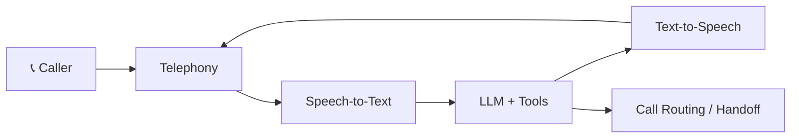

<!-- Header -->

  

  
  
  
  
  

---

### 🎙️ Now

| Role | Where | What I do |
|---|---|---|
| **Voice AI Engineer** | [Skimmy AI](https://skimmy.ai) · Sep 2026 → now | Core voice stack: LLMs, speech‑to‑text, text‑to‑speech, telephony, call routing |
| **Project Lead Developer** | [CloudOrdinate](https://cloudordinate.com) · Sep 2024 → now | Lead web + mobile builds for GCT, Express Connection, Apogeu, Moodzy |
| **Co‑founder** | Purple Store | Fashion e‑commerce brand |

### 🔊 How a Skimmy call works

---

### 🛠️ Featured work

<table>
<tr>
<td width="50%" valign="top">

<b>Skimmy AI</b> · <i>in development</i> 
AI receptionist that answers every call instantly. 
<code>Voice AI</code> <code>LLM</code> <code>STT/TTS</code> <code>Telephony</code>
</td>
<td width="50%" valign="top">

<b>GCT · Gulf Container Terminal</b> 
Depot software: container tracking, EIRs, gate control, invoicing, reports. 
<code>Next.js</code> <code>Node.js</code> <code>PostgreSQL</code>
</td>
</tr>
<tr>
<td valign="top">

<b>Moodzy</b> 
Mood tracking for neurodivergent users. 
<code>React</code> <code>Node.js</code> <code>PostgreSQL</code>
</td>
<td valign="top">

<b>Apogeu</b> 
Freight forwarding & customs, Lisbon. 
<code>PHP</code> <code>Tailwind</code>
</td>
</tr>
</table>

<b>➕ More client builds</b>

 

| Project | What | Stack |
|---|---|---|
| Express Connection | Freight & warehousing, Dubai | PHP · Tailwind |
| Express Shipping | Freight forwarding & ISO tanks | PHP · Tailwind |
| Trans Logistikz | Sea freight, ISO tanks, customs | PHP · Tailwind |
| Trade & Trade | Commodity trading, UAE | PHP · Tailwind |
| Global Cargo | Sea & air freight, customs | PHP · Tailwind |
| Purple Store | Hijab & fashion store (co‑founder) | Odoo |

<b>💬 What clients say</b>

 

> “We run the depot on this software every day. EIRs, container tracking and reports sit in one place now, and the gate team picked it up within a day.”
> — **Rizwan**, GCT

> “Both our sites finally look like the businesses we are. Clients find what they need and enquiries come straight to us.”
> — **Faizan Nisar**, Express Connection & Express Shipping, Dubai

---

### 🧰 Stack

`Framer` · `Odoo` · `Hetzner` · `LLMs` · `STT` · `TTS` · `Telephony`

---

### 📈 Activity

  

  

<picture>
  <source media="(prefers-color-scheme: dark)" srcset="https://raw.githubusercontent.com/aliahmedumar/aliahmedumar/output/snake-dark.svg"/>
  
</picture>

  <a href="PORTFOLIO_URL"><b>📅 Book a 30‑min call</b></a> · <a href="mailto:ali@cloudordinate.com">ali@cloudordinate.com</a>

